# Walkthrough: turn scanned pages into text

Use OCR Simple GUI to read prepared page images, check the text, save corrections,
and download the results. OCR means optical character recognition: software reads
printed words in an image and turns them into editable text.

Install it with one click, then open it with one click. The installer and the
app icon were tested on Linux and Windows. The macOS installer is built and was
not run on a Mac for this guide.

This walkthrough submits all 386 prepared page images from *The Four Men: A Farrago*
by Hilaire Belloc, then reviews representative pages. You can submit a whole
book as a folder or ZIP. The app is not limited to a short page selection.

The full-book run succeeded with all 386 pages in version 0.5.7. The screenshots
show that run and its input routes. We checked a saved correction, both exports,
and persistence after closing the tab and restarting the server. This verifies
the workflow, not the accuracy of every page.

The [demo sequence](../plans/2026-11-14-four-men-demo-sequence.md) separates
recording notes and runtime evidence from these user steps.

## Agent Index

- **Kind:** usage
- **Status:** draft
- **Read when:** following one-click install, one-click run, and the Four Men screenshot guide.
- **Search terms:** walkthrough, one-click install, one-click run, Four Men, screenshots.

## One-click install

Open the installer and click **Install**. You do not type the install commands.

On Linux, the window asks to install OCR Simple GUI and its Python packages
for your user account. Click **Install**. Wait until the log says
"Installation complete. Open OCR Simple GUI from your applications menu."
Then click **Close**.

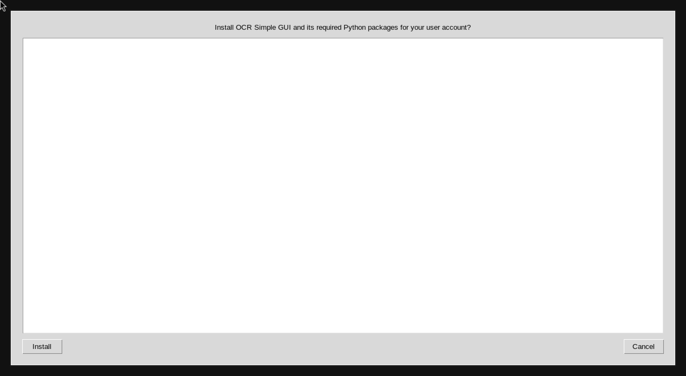

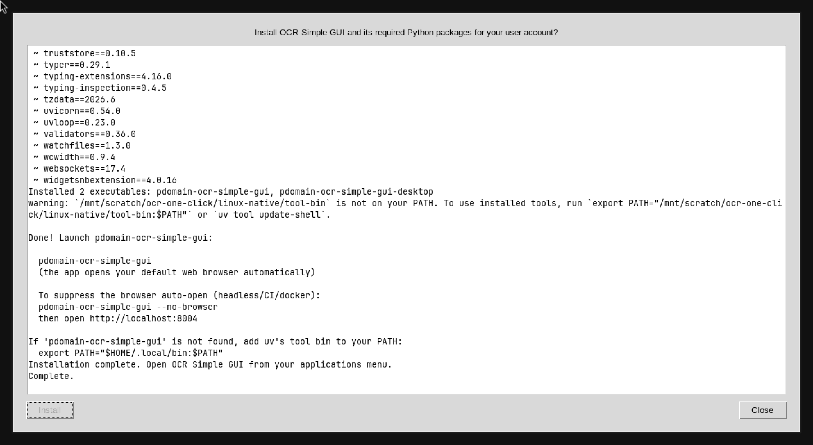

On Windows, open OCR Simple GUI Setup. The window asks to install the app for
this Windows account. Internet is required for Python and the OCR packages.
Windows may ask permission for the Microsoft runtime. Click **Install**.

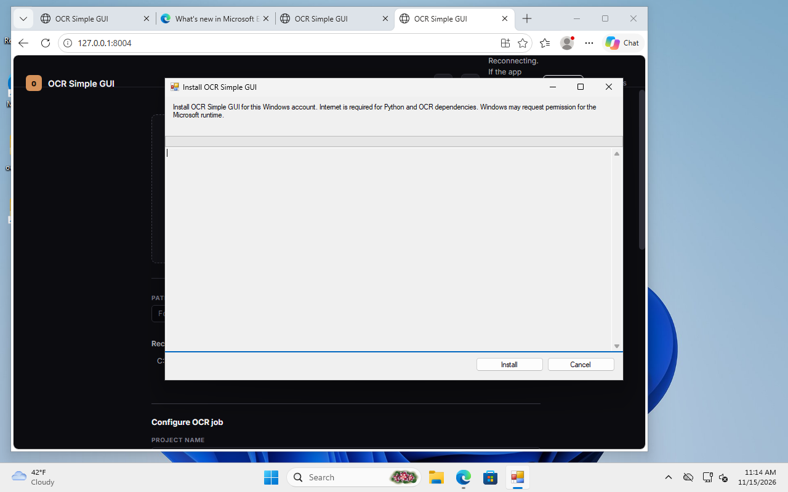

The Linux log can show a path warning from the test account. You do not type
that warning. The line that matters is the instruction to open the app from
your applications menu.

## One-click run

Open **OCR Simple GUI** from your applications menu on Linux, or from the
Start menu on Windows. The app opens in your browser. You do not open a terminal.

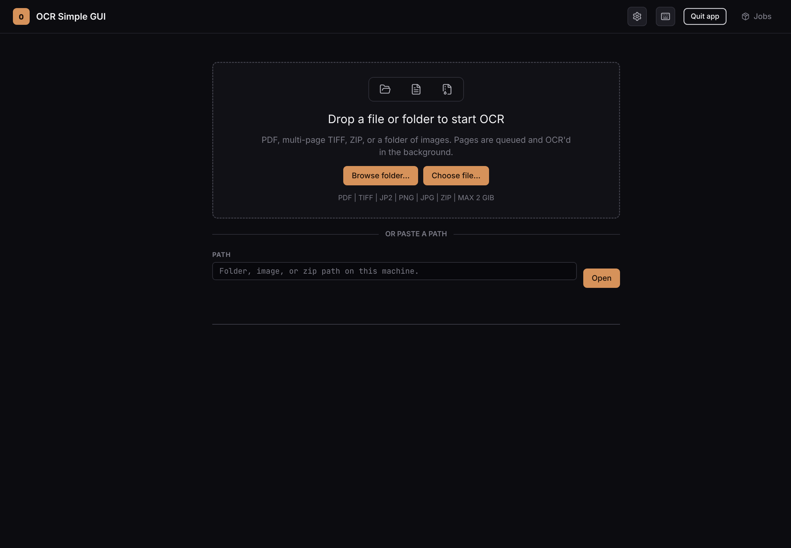

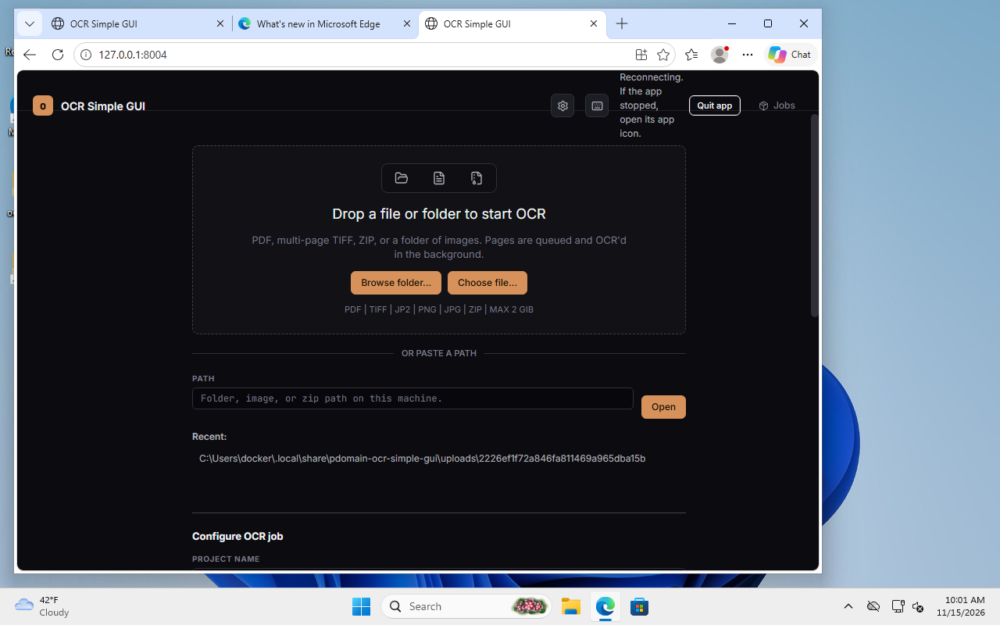

The Windows capture shows two browser tabs and a reconnecting notice. If the
page says the app stopped, open the app icon again. A second open uses the
app that is already running.

**Quit app** is in the top bar. Use it to stop the app. If other browser tabs
are open, the app asks you to confirm before quitting all of them. Closing one
tab does not stop the app.

## Before you start

[Install the app](../../README.md#install) first. Keep your original scans and
prepared images. Downloaded OCR results do not replace that source material.

Use prepared PNG, JPG/JPEG, TIF/TIFF or JPEG 2000 images. The recognized JPEG 2000
extensions are JP2, J2K, JPF, JPX and JPM. A ZIP is one archive containing several
files. Whole-folder and ZIP routes are below.
Browser uploads default to a 2 GiB total size limit and 5,000 files per request;
check the size limit displayed by your app. GiB is about 1.07 billion bytes.
ZIP extraction also defaults to a 2 GiB limit on the expanded contents.

## Step 1: Start from the open app

The one-click run above is the way to open the app. The book screenshots
below come from the version 0.5.7 recording. That home screen is the same
upload page, without the later **Quit app** button.

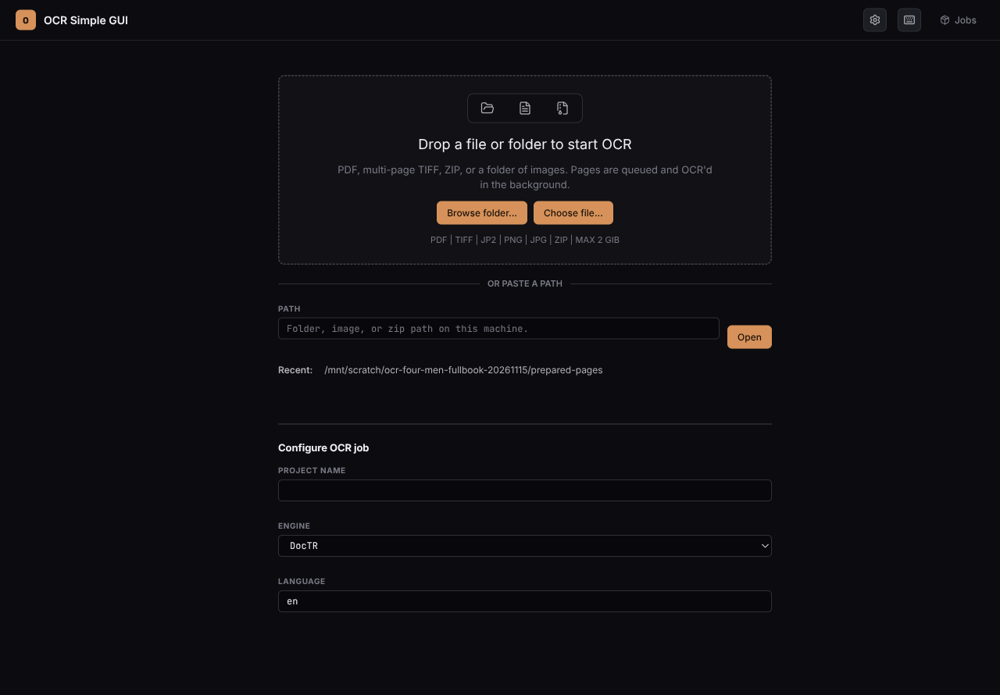

## Step 2: Download the source scans outside OCR Simple GUI

For this example, use the Internet Archive item
[`fourmenfarrago00belluoft`](https://archive.org/details/fourmenfarrago00belluoft).
The project's saved comments name this exact item as their source.

1. Open that item page in your browser.
2. Under **DOWNLOAD OPTIONS**, choose **SINGLE PAGE RAW JP2 ZIP** for the raw
   scan archive. The recorded transfer saved `fourmenfarrago00belluoft_raw_jp2.zip`.
3. Use your browser's download panel to check that the transfer finishes. Keep
   this raw archive separate from your prepared pages.

The browser and Internet Archive handle this download. OCR Simple GUI's source
picker opens local files and paths; it has no Internet Archive download control.
Do not choose IA's existing full text as the input for this OCR demonstration.

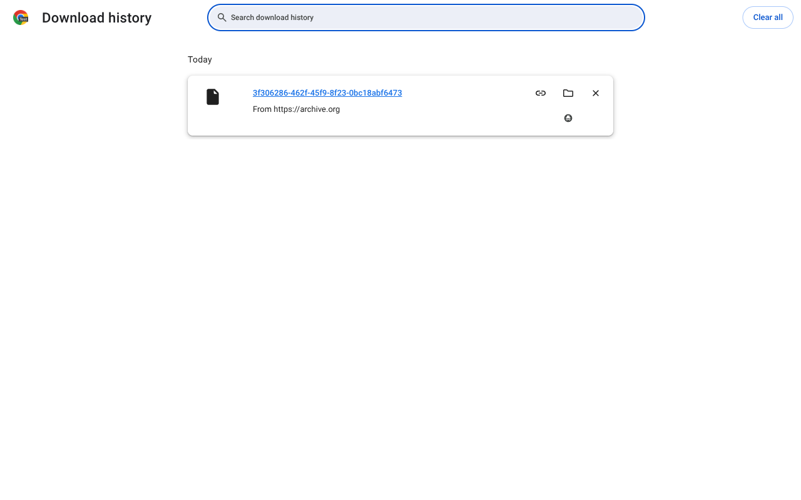

The capture browser displays a temporary transfer identifier. The saved archive
uses the filename above. This is the raw scan download, not an OCR-result ZIP.

## Step 3: Switch to prepared pages and submit the whole book

“After you've prepared the pages, cropped, straightened, and adjusted them...”
choose the prepared images for OCR. Preparation happens before this walkthrough's
OCR steps. This guide does not demonstrate a preparation tool.

For your own book, put all prepared page images in one folder with no subfolders.
Keep filenames in reading order: the app sorts by filename, not by the order you
click files. Number names consistently, such as `page001.png` and `page002.png`.
You do not need this project's local files to follow the steps.

For this project's recording, the existing source directory is:

```text
/mnt/work/projects/pgdp/post-processing/the-four-men/projectID674a598474ee1_images/
```

It contains 386 prepared PNG pages and 31 `i_*.jpg` illustration/title assets.
All 417 files have image extensions the app recognizes, so opening that mixed
folder directly would also submit the extra JPEG assets as extra pages.

For the recording, we copied all 386 PNGs into a separate page-only folder,
leaving the originals untouched. Include `f001.png` through `f010.png`, the
additional `f003b.png` and `f003p.png`, and every file from `p011.png` through
`p384.png`. Keep the blank page, plate and publisher's final page: these are
part of the prepared page set. Leave the 31 supplementary JPEG assets out. The filename
order begins `f001.png`, `f002.png`, `f003.png`, `f003b.png`, `f003p.png`,
then continues through the front matter and p011–p384.

These prepared inputs already existed. They are not claimed outputs of a new IA
download or preparation run. The page-only folder and flat ZIP were created
in scratch storage, leaving the original PGDP files unchanged.

Choose one whole-book input route:

- **Local folder:** under **OR PASTE A PATH**, enter the page-only folder's path
   and click **Open**. This reads files where the server can access them, without
   uploading copies. Local folder collection reads only that folder's immediate
   files; it does not search subfolders.
- **Browser folder upload:** click **Browse folder...** and choose the page-only
   folder. This uploads copies through the browser. It is a real folder chooser
   where the upload picker is shown. The capture browser successfully uploaded
   all 386 files this way; support in other browsers can vary. Keep the input flat: uploaded paths are reduced
   to filenames, so files with identical names in subfolders can overwrite each
   other. This is not a preserved recursive folder import.
- **Whole ZIP:** put those same 386 PNGs directly at the ZIP's root, without an
   enclosing folder. Click **Choose file...** and select the ZIP, or drag the ZIP
   onto the drop area. The app uploads and extracts it. In local mode you can
   instead paste a server-accessible ZIP path and click **Open**. Both ZIP routes
   collect only root-level images after extraction; nested page folders are not
   searched. A ZIP of the unfiltered source directory would include the extra JPEG assets.

The full-book run used the local page-only folder route with **Managed (download)**
output. Managed output is different from managed-server mode: a managed server
offers uploads but hides and rejects local source paths. In a container, a pasted
path must exist inside that container. **Clear** resets a chosen input.

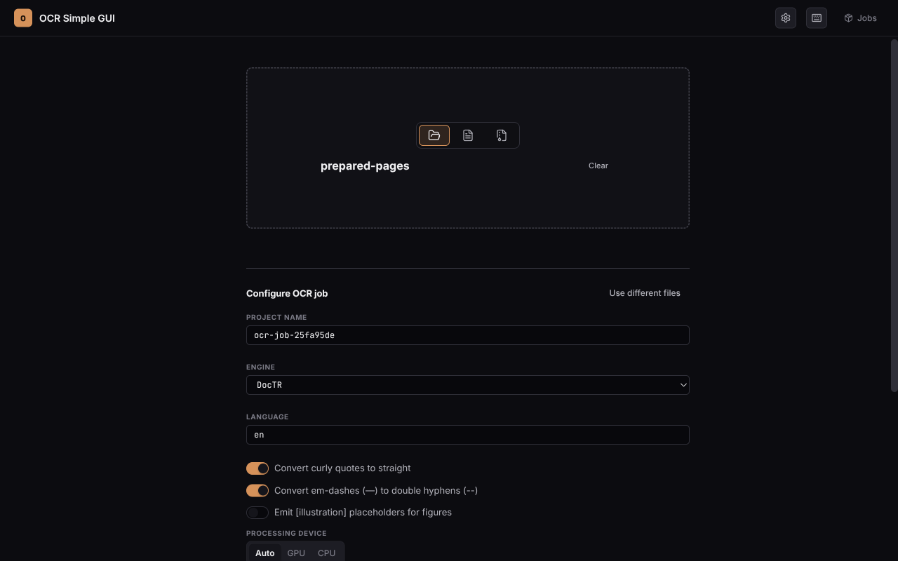

## Step 4: Choose Managed output and check OCR settings

Scroll below the file box. Under **Where should results land?**, explicitly
choose **Managed (download)**. This keeps the results in the app for ZIP download.
The job-page download buttons require Managed output and a successful job.

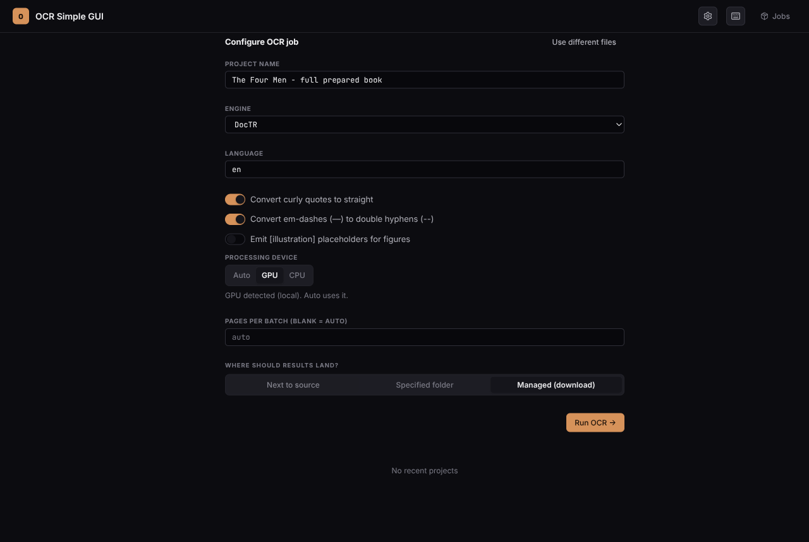

- **Project name:** use `The Four Men - full prepared book`. The combined text file uses
  the project name.
- **Engine:** choose **DocTR** for this demonstration. **Tesseract** is another
  choice when installed and available. This full-book run used DocTR; Tesseract
  was not tested on the full book.
- **Language:** use `en` for English. This setting applies to Tesseract.
- **Processing device:** leave **Auto** selected. The line beneath the selector
  reports whether Auto will use a GPU, the graphics processor, or the CPU, the
  main processor. The recorded run selected **GPU** explicitly. Choose **CPU**
  if required. GPU availability depends
  on your installation; do not assume every machine offers it.
- **Pages per batch:** leave blank to let the app choose.
- **Text options:** review the switches that convert curly quotes to straight
  quotes and em dashes to double hyphens. Both default to on. The optional
  `[illustration]` placeholder switch defaults to off. Inspect its effect before
  relying on it for the illustrated p013.

Other output choices serve different workflows. **Specified folder** writes
results to the path you supply in local mode. **Next to source** appears for a
pasted folder-path source and writes beside the source images. Source inspection
confirmed that uploaded files and a browser folder upload do not enable that
choice. Keep **Managed (download)** for this walkthrough.

## Step 5: Run OCR and watch progress

Click **Run OCR →**. The job page shows progress as pages finish. Confirm it is
processing all 386 prepared pages. Check that no supplementary JPEG assets were added.

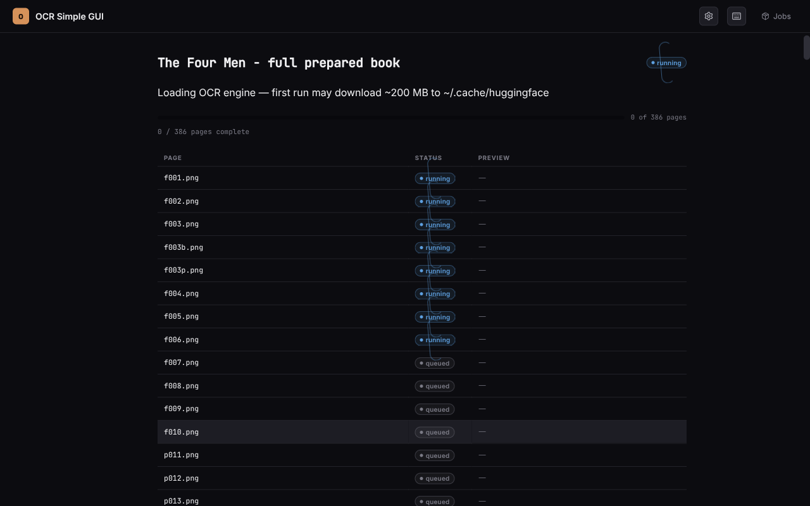

Wait for the job to finish. Runtime depends on the pages, device, model loading,
and any first-use model downloads. No duration is promised for this full-book
job. Earlier one-page measurements are not estimates for it.

If the job fails, read its error before retrying. Do not download an incomplete
job as though all pages succeeded.

## Step 6: Review the results and identify the job

A successful job shows **succeeded** and a row for each page. Check the 386-page
total, filenames and statuses. Completion does not mean the text is error-free.
Blank or illustration-only pages may have little or no text.
**Copy path** copies the results location on your
computer. **Re-run all** reads the job again; a full rerun can discard saved
edits, so download your checked text first.


The job ID is the long identifier in the browser address after `/jobs/`.
For example, in `/jobs/1a55197f-8e2e-40e8-beb1-d32a286c472f`, that final
identifier is the job ID. A page address adds `/pages/` and a page index after
it. The ID also names the downloaded ZIP and the job folders below. It is
separate from your project name.

## Step 7: Open a page, correct the text and save

Click a page row. The image appears on the left and its text on the right.
Green word boxes show recognized word positions. Use **−**, **+**, **Fit** and
**100%** to inspect the image. **← Prev** and **Next →** move between pages.

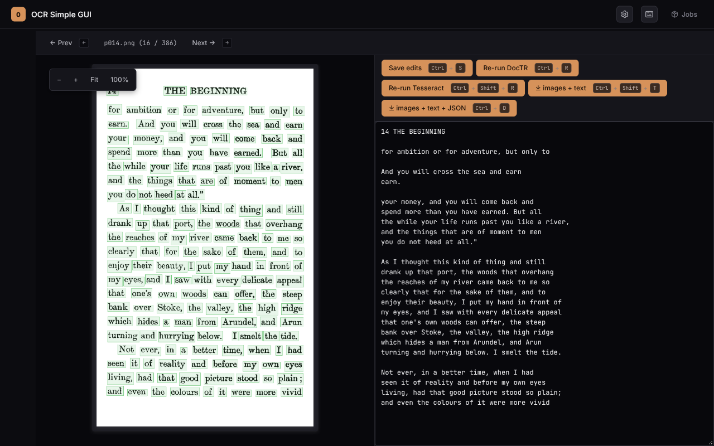

Inspect representative pages after the full run: front matter, p013's opening
letter and heading, p014's running header, p021's illustration, and p384's final
publisher list. This is a demonstration of review, not a claim to have proofread
the entire book. Correct only
what the page supports; no particular recognition mistake is predicted here.

Click **Save edits**, or press Ctrl+S. Wait for the **Saved** message before
leaving the page. Repeat for other pages that need corrections.

In the recorded p014 example, OCR misplaced “earn.” after the following line.
We moved it back before “And you will cross the sea and earn”, matching the scan.
The saved correction survived reopening and appeared in both downloads.

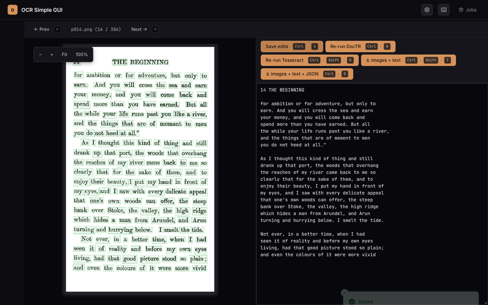

**Re-run DocTR** and, when available, **Re-run Tesseract** read the current page
again. They are optional controls, not required steps in this sequence.

## Step 8: Download both ZIP choices

Return to the job page with the browser's Back button. After the Managed job
succeeds, download each ZIP separately. A ZIP is one archive containing several
files. Both buttons request the same job-ID filename, so your browser may rename
the second copy. Keep track of which button produced each archive.
The download screenshot is the same capture as the results screenshot. Both
download buttons are on that job page.

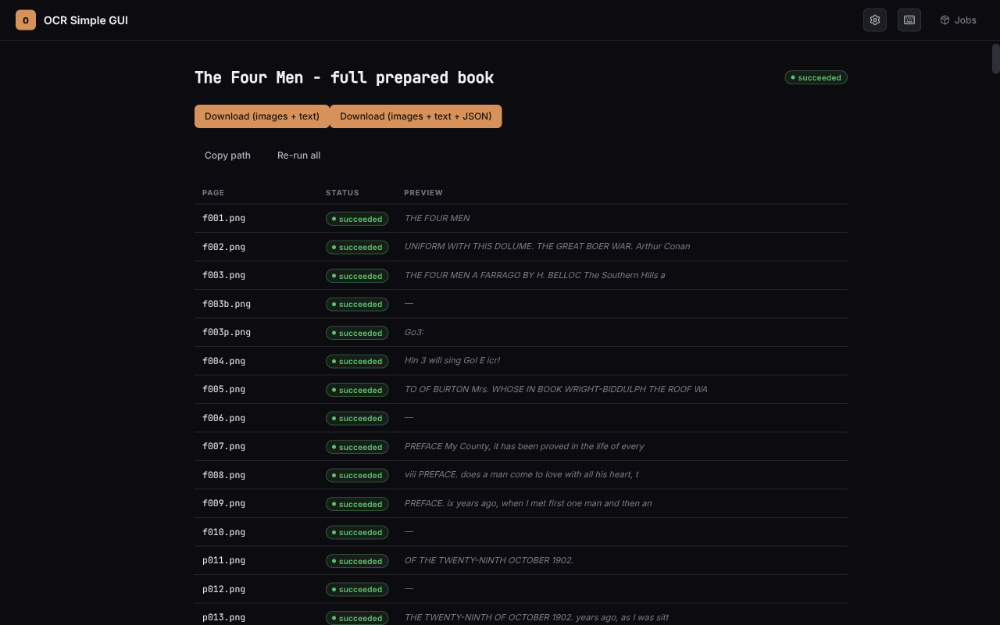

| Job-page button | Text and data requested |
| --- | --- |
| **Download (images + text)** | Per-page text and the combined project text. |
| **Download (images + text + JSON)** | The same text, plus structured page data. |

JSON is a structured data format for software. The page data can contain
recognized text, word positions and saved edited text. Edited text does not
mean the original word boxes have been adjusted to match your corrections.

The page-view shortcuts use **⤓ images + text** and **⤓ images + text + JSON**.
Despite these labels, neither ZIP from this 386-page Managed run contained source
images. Keep your prepared originals.

Extract both downloads. Check for a text file for each of the 386 source stems,
from `f001.txt` through `p384.txt`, plus the combined project text. Check that
the reviewed pages contain saved corrections and that the combined text follows
the filename order. Check the second archive for page JSON.

This run verified 386 page text files plus
`The_Four_Men_-_full_prepared_book.txt` in both ZIPs. The second also contained
386 page JSON files. The p014 correction was present in the per-page text,
combined text and JSON edited text.

Files normally go to your browser's Downloads folder, unless you chose another
destination.

## Where your jobs are kept

Click **Jobs** at the top right to open the job list, then **Open** for the job
you want. Recent projects on the home page also open jobs. Prior testing found
stale page counts and status in Recent projects; inspect the open job itself.
The header Jobs list is separate from the gear menu's **Settings > Jobs**.

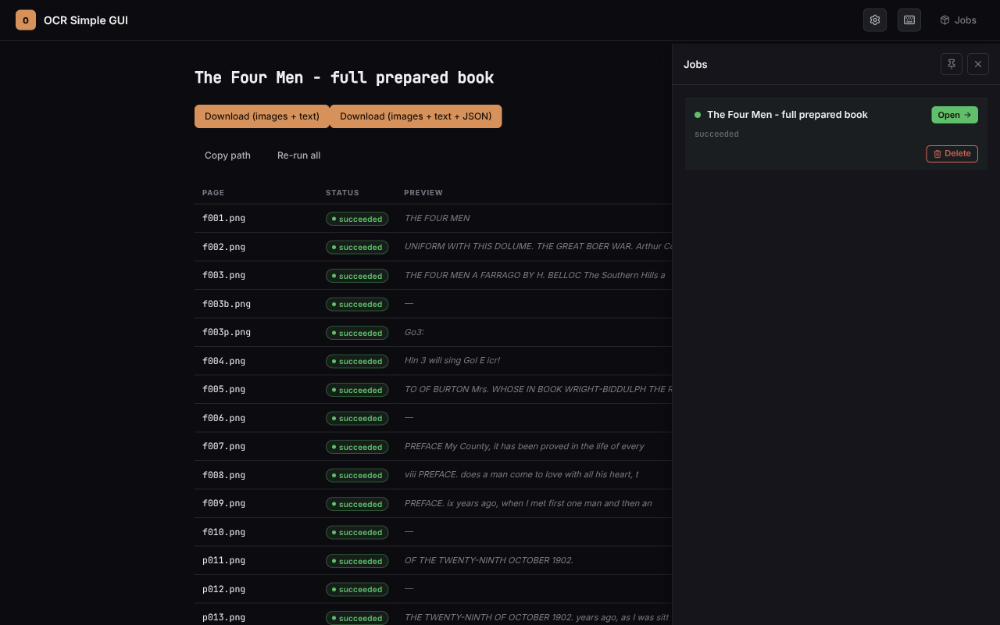

Keep downloads before using **Delete**. The prior 0.5.7 review found that deletion
happened without confirmation and left uploaded image copies behind. Do not
use Delete as a promise of complete file cleanup.

These are default Linux locations inside your home folder; configured locations
may differ. Replace `<job ID>` with the identifier from the browser address.

| What | Default location inside your home folder |
| --- | --- |
| Job data, recognized text and edits | `.local/share/pdomain-suite/simple-gui/projects/<job ID>/` |
| Output files used for ZIPs | `.local/share/pdomain-ocr-simple-gui/outputs/<job ID>/` |
| Uploaded image copies | `.local/share/pdomain-ocr-simple-gui/uploads/` |

To change where new jobs are stored, open the gear menu, select **Jobs**, enter
a folder and click **Save**. Existing jobs stay in their earlier location.

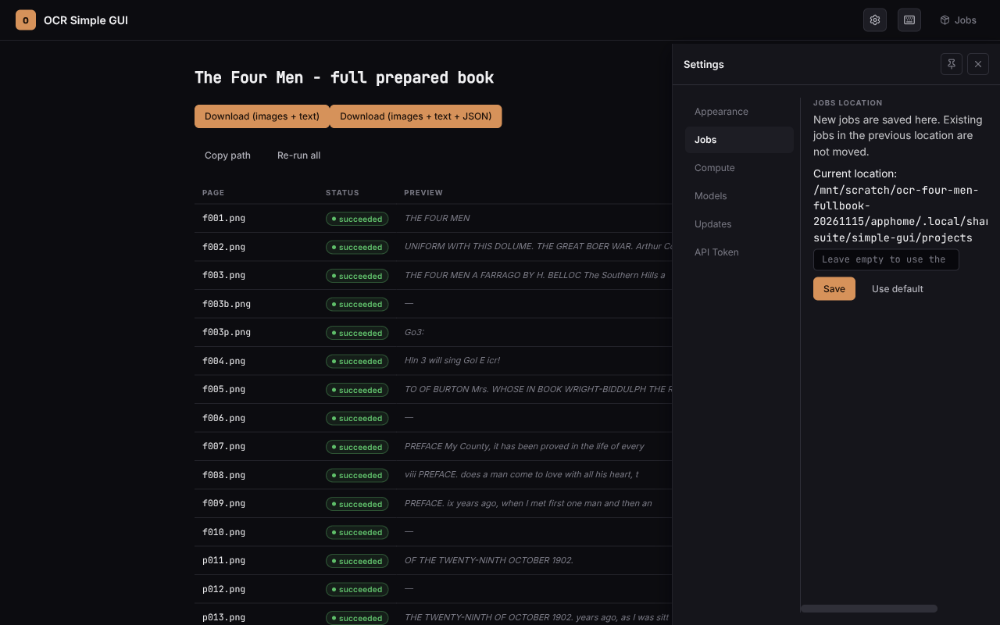

## Stop the app

Save edits and wait for OCR to finish before stopping. Click **Quit app**.
If other browser tabs are open, confirm that you want to quit all of them.

Closing one browser tab leaves the app running and stored jobs on disk.
We verified the completed 386-page job and the saved p014 correction after
closing and reopening a tab, then after stopping and restarting the server.
Unsaved text is not a saved result. Do not treat closing the tab as a stop button.

Do not stop the app by matching its process name. That can stop more than the
copy you started.

## About the example pages

The new example is Hilaire Belloc's *The Four Men: A Farrago*. The project's
saved comments identify [Internet Archive item
fourmenfarrago00belluoft](https://archive.org/details/fourmenfarrago00belluoft).
IA lists London publisher T. Nelson and contributor Kelly - University of Toronto,
with an uncertain publication date. The project comments describe the work as
published in 1912; that does not establish this scanned edition's date.

Prepared input comes from the existing PGDP project `projectID674a598474ee1`,
all 386 PNG page files. The raw IA archive and these prepared PNGs are distinct inputs.
The nine earlier screenshots remain as unused historical assets. They credit
Kenneth Grahame's *The Wind in the Willows*, Charles Scribner's Sons, New York,
1908; Cornell University Library scan, IA item
[`cu31924028200164`](https://archive.org/details/cu31924028200164), leaf n15.
The screenshots displayed in this walkthrough use the Four Men run instead.
